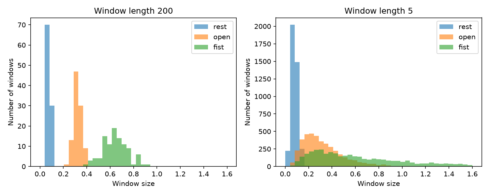

# Prosthetic Hand Control Simulator

A learning simulation that guesses a hand gesture (rest, open or fist) from a fake muscle signal. It uses synthetic data only. It is **not** a medical device.

## How it works

1. Make a fake muscle signal for each gesture.
2. Give each gesture its own loudness and its own smoothness.
3. Cut the signal into short windows and measure two things for each window: its average size and its roughness.
4. Learn the typical size and roughness of each gesture.
5. Guess a new window by picking the gesture with the closest typical pair.
6. Score the guesses on new signals and print a results table.



With a window of 200 readings the three gestures stand apart. With a window of 5 readings, `open` and `fist` overlap and the classifier makes mistakes.

## How to run

```bash
git clone https://github.com/playfu1-d0ubt/prosthetic-hand-simulator.git
cd prosthetic-hand-simulator
python3 -m venv venv
source venv/bin/activate
pip install -r requirements.txt
python main.py          # train, test and print results
python plot.py          # save the comparison chart
python noise_sweep.py   # accuracy as background noise rises
python -m pytest        # run the tests
```
## Harder signals

Real muscle signals have background noise. `noise_floor` adds the same random noise to every gesture. As it rises, the quiet gestures drown in it.

| Noise floor | Accuracy |
| --- | --- |
| 0.0 | 99% |
| 0.3 | 99% |
| 0.6 | 93% |
| 1.0 | 78% |

I also tried adding a second feature, roughness, hoping it would help. It did not. Size and roughness both come from the same noisy signal, so the noise hides both. Size alone scored 77%, roughness alone 72% and both together 78% at a noise floor of 1.0. A second measurement of the same noise cannot recover what the noise hides.

## Limitations

- All data is fake. It is random noise, not real muscle signal, so real signals would be messier.
- With no background noise the three gestures are far apart, so the task is easy.
- It uses two features, size and roughness, but both come from the same signal, so noise hurts both.
- A short window is quick but noisy. A long window is steady but slow to react.
- It is a learning simulation, not a medical device.
- Tested on Linux Mint only.

## What I learned

In Song Quiz, all my code was in one file. Here I split it into `signals.py`, which makes the fake signal, `features.py`, which turns the signal into one size number per window, and `classifier.py`, which learns the typical size of each gesture, guesses gestures and scores the guesses. This helped because it broke the project down into small groups of functions.

The bug that caught me most was a missing `return`. I noticed because `len()` failed with a `TypeError`, since the function gave back `None`. I fixed it by adding `return` to the last line.