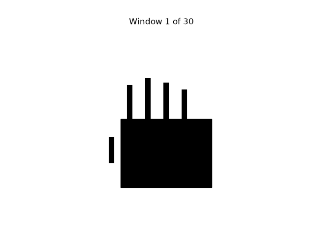

Readme · MD
# Prosthetic Hand Control Simulator
 
A learning simulation that guesses a hand gesture (rest, open or fist) from a fake muscle signal. It uses synthetic data only. It is **not** a medical device.
 
## How it works
 
1. Make a fake muscle signal for each gesture.
2. Give each gesture its own loudness and its own smoothness.
3. Cut the signal into short windows and measure two things for each window: its average size and its roughness.
4. Learn the typical size and roughness of each gesture.
5. Guess a new window by picking the gesture with the closest typical pair.
6. Score the guesses on new signals and print a results table.
7. Score a second method, k-nearest-neighbour, on the same windows and compare the two.

 
With a window of 200 readings the three gestures stand apart. With a window of 5 readings, `open` and `fist` overlap and the classifier makes mistakes.
 
## How to run
 
```bash
git clone https://github.com/playfu1-d0ubt/prosthetic-hand-simulator.git
cd prosthetic-hand-simulator
python3 -m venv venv
source venv/bin/activate
pip install -r requirements.txt
python main.py          # train, test and print both tables
python plot.py          # save the comparison chart
python noise_sweep.py   # accuracy as background noise rises
python demo.py          # show the hand reacting and save the GIF
python -m pytest        # run the tests
```
 
## Files
 
| File | What it does |
| --- | --- |
| `signals.py` | Makes the fake muscle signal for each gesture, with optional background noise |
| `features.py` | Cuts a signal into windows and measures the size and roughness of each |
| `classifier.py` | Learns the typical size and roughness of each gesture, guesses gestures and scores the guesses |
| `knn.py` | Guesses a gesture from the k closest labelled example windows |
| `compare.py` | Builds one labelled dataset and scores both classifiers on it |
| `main.py` | Trains, tests and prints the results tables |
| `plot.py` | Saves the window-size comparison chart |
| `noise_sweep.py` | Shows how accuracy falls as background noise rises |
| `hand.py` | Draws a simple hand that opens and closes from an openness number |
| `demo.py` | Turns a changing signal into openness values and animates the hand |
 
## Typical-pair accuracy
 
Real muscle signals have background noise. `noise_floor` adds the same random noise to every gesture. As it rises, the quiet gestures drown in it.
 
| Noise floor | Accuracy |
| --- | --- |
| 0.0 | 99% |
| 0.3 | 99% |
| 0.6 | 93% |
| 1.0 | 78% |
 
I also tried adding a second feature, roughness, hoping it would help. It did not. Size and roughness both come from the same noisy signal, so the noise hides both. Size alone scored 77%, roughness alone 72% and both together 78% at a noise floor of 1.0. A second measurement of the same noise cannot recover what the noise hides.
 
## Comparing two classifiers
 
`compare.py` scores the typical-pair classifier and k-nearest-neighbour (k=3) on the same synthetic test windows. Run `python main.py` to print the table.
 
| Noise floor | Typical-pair | KNN |
| --- | --- | --- |
| 0.0 | 99% | 100% |
| 0.3 | 99% | 100% |
| 0.6 | 93% | 95% |
| 1.0 | 78% | 75% |
 
In my runs, KNN was narrowly ahead from 0.0 to 0.6, by 1 to 2 points (95% against 93% at 0.6). The lead flipped somewhere between 0.6 and 1.0, and at 1.0 the typical-pair classifier led 78% to 75%.
 
My guess is that neighbours do well on clean data, but averaging holds up better once the noise gets heavy.
 
This is not enough to call. It is one pair of seeds and 300 synthetic test windows, so a 3 point gap is only about 9 windows.
 
## Showing the hand

`hand.py` draws a simple hand, and `demo.py` feeds it a signal that moves through rest, open and fist. The classifier guesses each 0.2 second window, and the hand opens or closes to match the guess.



Near the end of the fist stretch the hand twitches open for a moment. Those are windows the classifier guessed wrong, so it is the accuracy from the tables above shown as a hand.

## Limitations
 
- All data is fake. It is random noise, not real muscle signal, so real signals would be messier.
- With no background noise the three gestures are far apart, so the task is easy.
- It uses two features, size and roughness, but both come from the same signal, so noise hurts both.
- A short window is quick but noisy. A long window is steady but slow to react.
- The classifier comparison uses one pair of seeds, so small gaps between the two are not reliable.
- The hand is a simple drawing, not a model of a real prosthetic hand.
- It is a learning simulation, not a medical device.
- Tested on Linux Mint only.
## What I learned
 
In Song Quiz, all my code was in one file. Here I split it into `signals.py`, which makes the fake signal, `features.py`, which turns the signal into one size number per window, and `classifier.py`, which learns the typical size of each gesture, guesses gestures and scores the guesses. This helped because it broke the project down into small groups of functions.
 
The bug that caught me most was a missing `return`. I noticed because `len()` failed with a `TypeError`, since the function gave back `None`. I fixed it by adding `return` to the last line.
 
I thought adding a second feature, roughness, would cancel out the noise. It did not, because roughness was generated from the same noisy signal as size. This taught me that testing a plan can show it was incorrect, and that is still a result.
 
My tests helped when I moved the window functions around. They showed errors in how I moved the window cutting.
 
When I compared the two classifiers, I learned that both had to be scored on the same training and test windows, or the comparison would not be fair. I also put a `return` inside a loop by mistake, which made a scorer give 0.33% instead of 99%, so I now check where my `return` lines sit.

Animating the hand was the part I found hardest. I confused the function that creates the animation with the function that draws one frame, and I did not see why update had to sit inside make_animation. Once I thought of it as a flip book, where update draws one page and FuncAnimation flips through them, I could follow it. I also learned to keep the animation in a variable, or matplotlib throws it away.